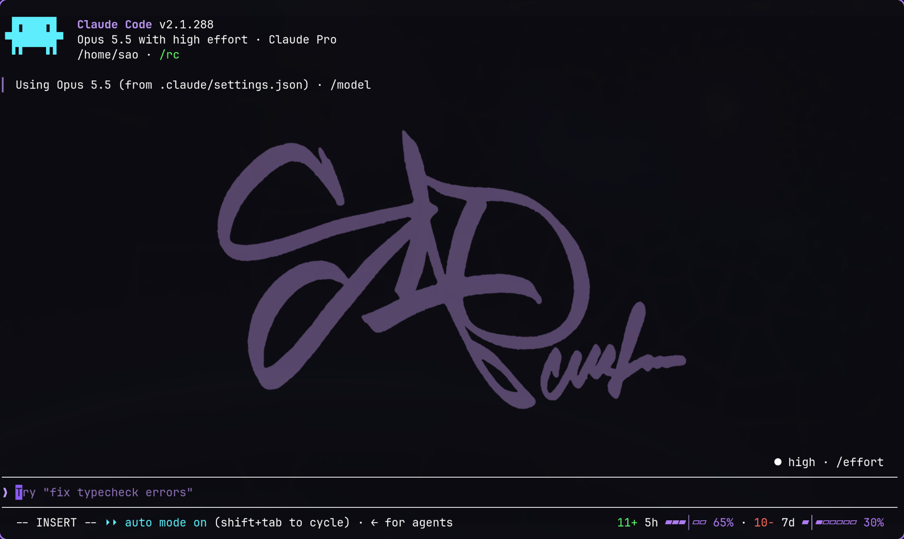
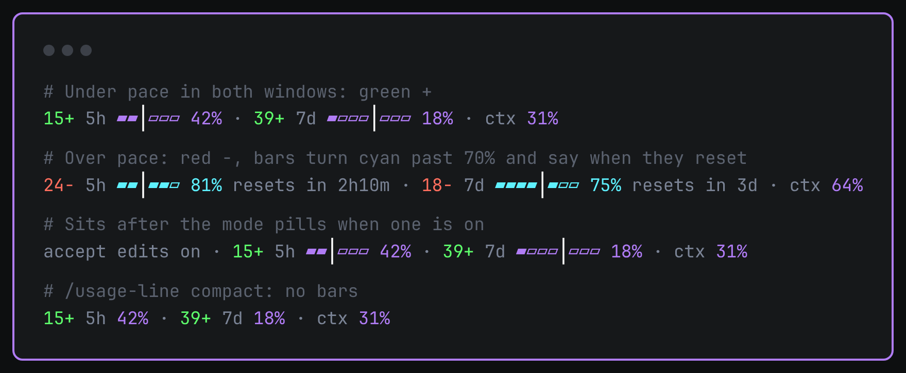

# usage-line

Your Claude usage in the Claude Code prompt footer, plus the number I
actually wanted: how far ahead of or behind an even pace you are.





A raw "42% of your 5-hour limit" doesn't tell you much on its own. 42% with
four hours left is fine. 42% twenty minutes in means you'll hit the wall
early. usage-line works out where you'd be if you spread usage evenly across
the window and shows the gap:

- `15+` in green: 15 points under even pace. You have room.
- `6-` in red: 6 points over. Slow down or you'll run out before the reset.

It does this for both the 5-hour and the weekly window. Each bar has one cell
per hour (5h) or per day (7d), with a `│` marking where you are in the
window right now.

## What it shows

```
15+ 5h ▰▰│▱▱▱ 42% · 39+ 7d ▰▱▱▱│▱▱▱ 18% · ctx 31%
```

| Piece | Meaning |
| --- | --- |
| `15+` / `6-` | Gap to even pace, in percentage points. Green under, red over. |
| `5h ▰▰│▱▱▱` | 5-hour window: filled cells are usage, `│` is the current hour. |
| `7d ▰▱▱▱│▱▱▱` | Weekly window: one cell per day, `│` is today. |
| `42%` | Percent of the limit used. Purple, cyan past 70%, pink past 90%. |
| `resets in 2h10m` | Shown once a window passes 70%. |
| `ctx 31%` | How full the context window is. |

Crossing 90% on either window also raises a toast, once per window per reset.

The figures come from the rate limits that come back with each Claude
response, so nothing polls. The line appears after the first reply in a
session. 5h and 7d need a Claude subscription. On an API key you get `ctx`
only.

## Show, shrink or hide it

```
/usage-line            cycle full → compact → off
/usage-line compact    15+ 5h 42% · 39+ 7d 18% · ctx 31%
/usage-line off        hide it
/usage-line full       bars back
```

Your choice is saved and carries over to new sessions.

## Install

It's a Claude Code plugin made of function hooks, so it needs a Claude Code
build that loads hooks modules. Built and tested on 2.1.288.

Clone it somewhere first. The rest of this README assumes
`~/.claude/mods/usage-line`:

```sh
git clone https://github.com/Steven-ODell/claude-usage-line ~/.claude/mods/usage-line
```

### One session at a time

```sh
claude --plugin-dir ~/.claude/mods/usage-line
```

Nothing changes in your settings. Leave the flag off and it's gone.

### Every session

Add the folder to `CLAUDE_CODE_PLUGIN_DIRS` in the `env` block of
`~/.claude/settings.json`:

```json
{
  "env": {
    "CLAUDE_CODE_PLUGIN_DIRS": "~/.claude/mods/usage-line"
  }
}
```

If you already load other plugin folders there, add this one with `:`
between paths (`;` on Windows). It has to be your user settings or your
shell environment. Claude Code ignores this variable in a project's settings.

Interactive sessions watch the folder, so a `git pull` reloads the plugin
without a restart.

### Let Claude install it

Paste this into Claude Code:

> Clone https://github.com/Steven-ODell/claude-usage-line into
> ~/.claude/mods/usage-line and add that path to CLAUDE_CODE_PLUGIN_DIRS in
> the env block of ~/.claude/settings.json, keeping any paths already there.

### Build your own instead

You'll probably want your own colors or layout anyway.
[SPEC.md](SPEC.md) is a prompt that describes the behavior without the
code. Paste it into Claude Code and it writes a version for you.

## Tests

```sh
claude plugin validate .
claude plugin test .
```

## License

MIT
